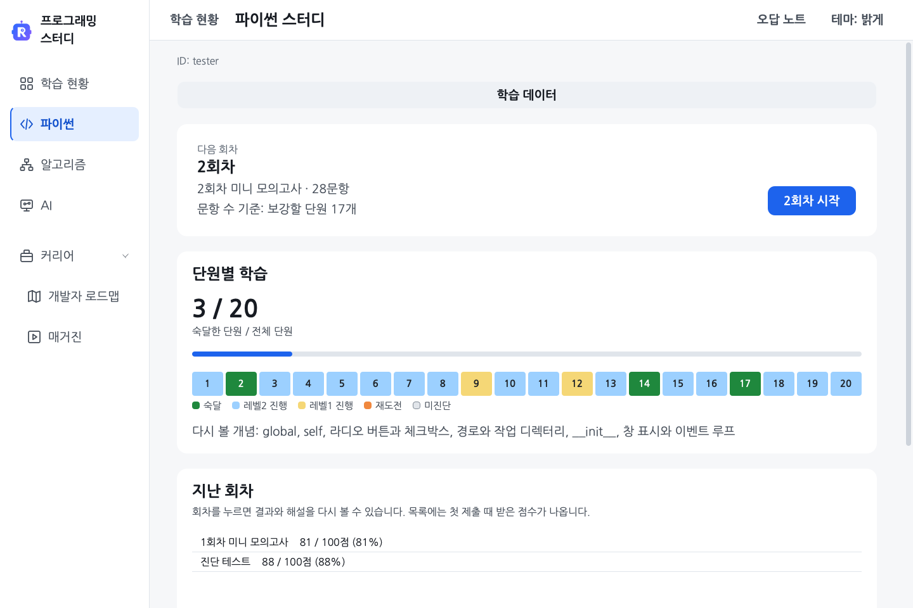

<picture>
  <source media="(prefers-color-scheme: dark)" srcset="assets/profile-dark.svg">
  
</picture>

# 프론트엔드 개발자 조민수입니다.

React·React Native·Next.js로 웹과 하이브리드 앱을 개발합니다. 인증·결제부터 백엔드 연동과 배포·운영까지 맡아 왔습니다.

지금은 스터디에서 쓰는 **프로그래밍 학습 프로그램**을 만들고, 팀원들과 풀이 기록을 활용한 문제 추천 모델을 개발하고 있습니다.

[기술 블로그](https://velog.io/@watermincho_96/posts) · [연락하기](mailto:whalstn8@naver.com)

## 공개 프로젝트

### [프로그래밍 스터디](https://github.com/WaterMinCho/programming-study)

파이썬·알고리즘·AI 문제 풀이, 채점, 오답 복습을 제공하는 데스크톱 프로그램입니다. 학습 화면과 비공개 수집 서버, 모델 실험에 사용할 공통 자료를 담당합니다.

Python · PyQt6 · SQLite

[설치와 사용법][study-start] · [프로젝트 구조][study-architecture] · [모델 개발 미션][study-models]

### [도서 검색](https://github.com/WaterMinCho/cdri-books-jominsu)

카카오 도서 검색 API로 검색·상세 조회·찜하기를 구현했습니다. 검색 조건별 캐싱, 무한 스크롤, 한글 입력 중 Enter 처리 코드를 확인할 수 있습니다.

React · TypeScript · TanStack Query · Vite

## 서비스 개발 경험

| 서비스 | 맡았던 개발 |
| --- | --- |
| [마펫쯔](https://mpz.kr) | 유기동물 입양 플랫폼의 인증 통합, DB 분리 이관, 통합 백오피스 |
| 강아지학교 | 반려생활 교육·커머스의 영상 강의, PayApp 결제, 상담 채팅과 배포 |
| Rround | 커머스 앱의 웹뷰, Turborepo 모노레포, AWS·Jenkins 배포 환경 |

## 사용 기술

**화면** · React, React Native, Next.js, TypeScript, TanStack Query

**서버·운영** · Python, Django, Supabase, AWS, nginx

[study-start]: https://github.com/WaterMinCho/programming-study/blob/main/docs/LEARNER_START.md
[study-architecture]: https://github.com/WaterMinCho/programming-study/blob/main/docs/ARCHITECTURE.md
[study-models]: https://github.com/WaterMinCho/programming-study/blob/main/docs/LEARNING_MISSIONS.md
